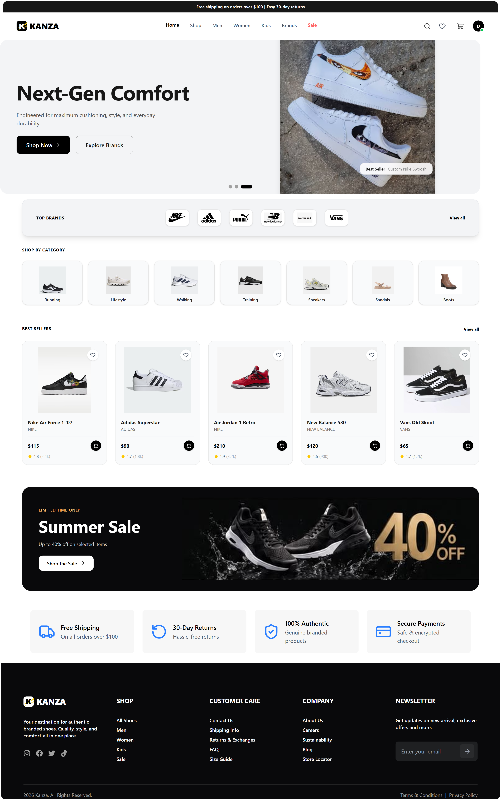
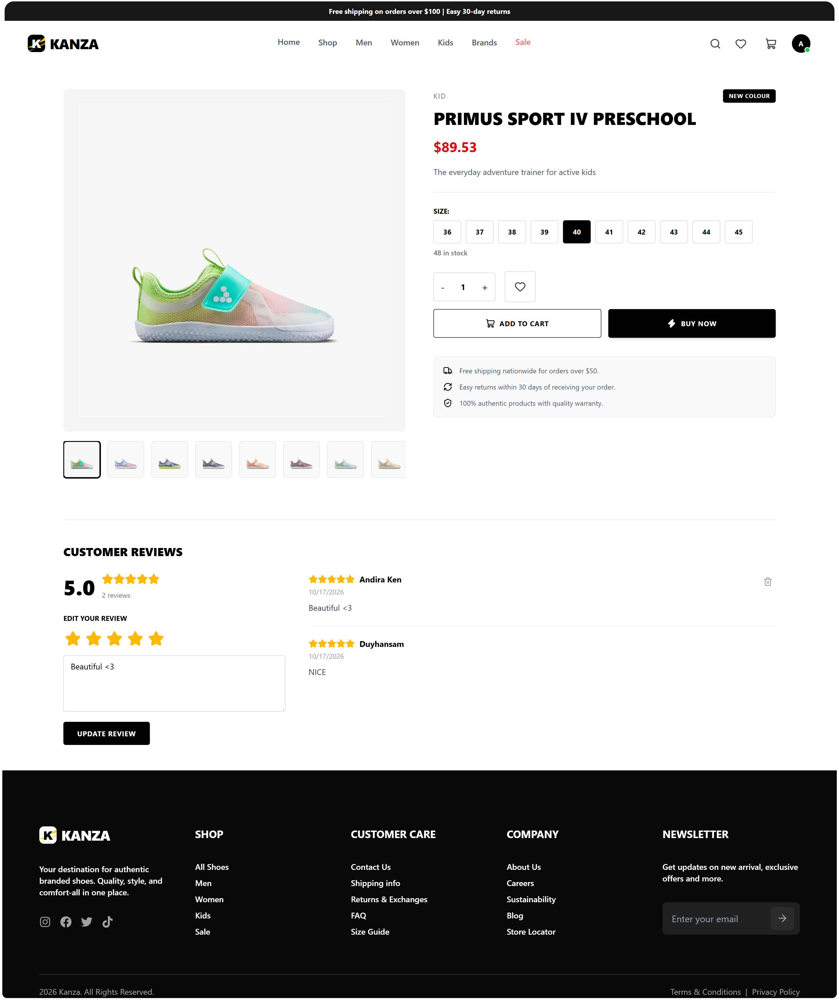
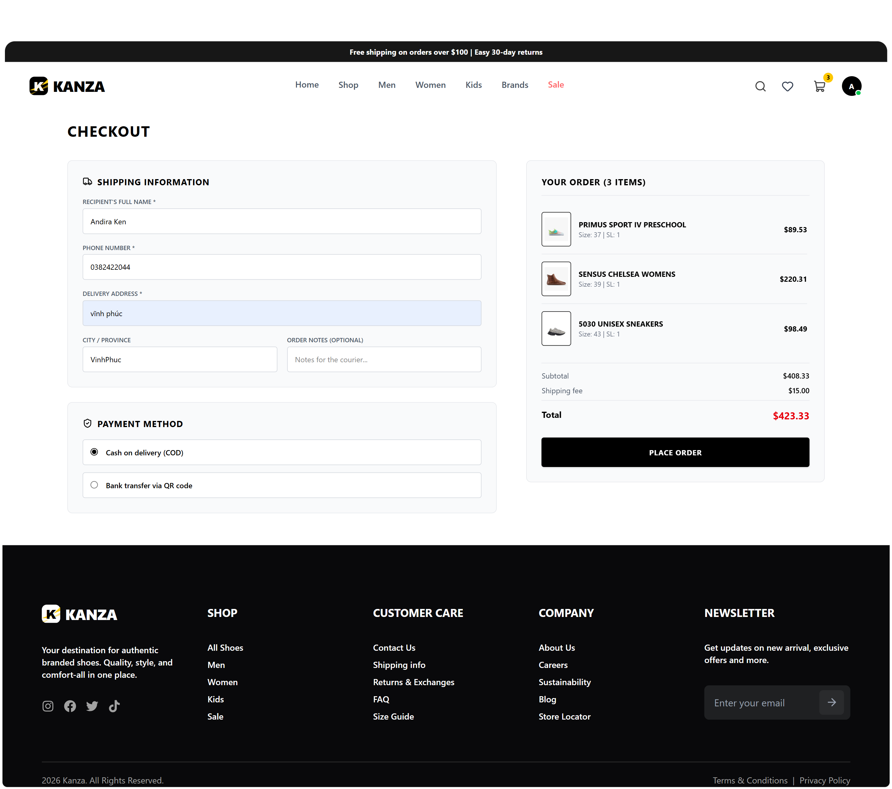
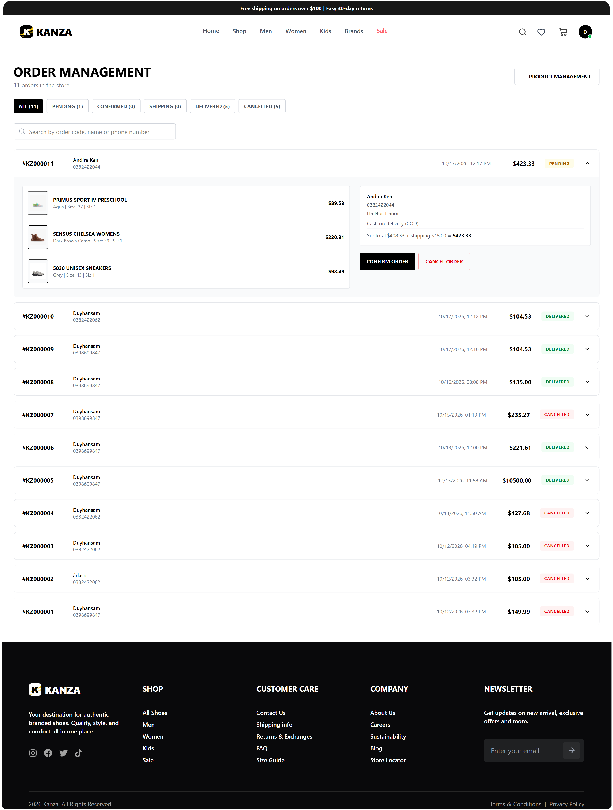

# Kanza Store - Fullstack E-Commerce

Website bán giày trực tuyến gồm **React + Tailwind CSS** ở frontend và **Spring Boot + MySQL** ở backend. Dự án có đủ luồng mua hàng thật: duyệt sản phẩm, giỏ hàng, đặt hàng có trừ tồn kho theo size, đánh giá sản phẩm, và trang quản trị cho admin.


## Ảnh chụp màn hình

| Trang chủ                          | Trang sản phẩm                           |
| ---------------------------------- | ---------------------------------------- |
|  |  |

| Thanh toán                                 | Quản lý đơn hàng (Admin)                           |
| ------------------------------------------ | -------------------------------------------------- |
|  |  |

## Tính năng

### Khách hàng

- **Tài khoản:** đăng ký, đăng nhập (JWT), quên và đặt lại mật khẩu, trang hồ sơ, đổi mật khẩu.
- **Duyệt sản phẩm:** trang Shop, Men, Women, Kids, Sale; trang theo loại giày (Running, Walking, Boots...); trang theo thương hiệu; tìm kiếm theo tên; sắp xếp theo giá và tên.
- **Chi tiết sản phẩm:** thư viện ảnh, chọn màu, chọn size (size hết hàng bị khóa), đánh giá sao và bình luận.
- **So sánh sản phẩm:** chọn tối đa 3 sản phẩm để so sánh cạnh nhau.
- **Giỏ hàng và Wishlist:** khách chưa đăng nhập lưu trên trình duyệt, khi đăng nhập thì tự gộp vào tài khoản; đã đăng nhập thì lưu ở server.
- **Đặt hàng:** thanh toán giỏ hàng hoặc "Mua ngay", xem lịch sử đơn, xem chi tiết đơn, hủy đơn khi còn ở trạng thái chờ xác nhận.
- **Đánh giá:** chỉ người đã nhận hàng mới được đánh giá, mỗi người một đánh giá cho mỗi sản phẩm và có thể sửa hoặc xóa.
- **Khác:** đăng ký newsletter, các trang thông tin cửa hàng, trang 404 và màn hình báo lỗi thay vì trang trắng.

### Quản trị viên (role ADMIN)

- **Sản phẩm:** thêm, sửa, xóa; nhiều màu cho mỗi sản phẩm; upload ảnh; quản lý tồn kho theo từng size.
- **Đơn hàng:** xem toàn bộ đơn, lọc theo trạng thái, tìm theo mã đơn, tên hoặc số điện thoại, đổi trạng thái theo đúng luồng
  `Chờ xác nhận -> Đã xác nhận -> Đang giao -> Đã giao` (hủy được khi chưa giao).

## Điểm kỹ thuật đáng chú ý

- **Giá do server tính:** trình duyệt không gửi giá, backend lấy giá từ DB khi tạo đơn nên không thể sửa giá từ phía client.
- **Tồn kho an toàn khi nhiều người mua cùng lúc:** trừ kho bằng một câu `UPDATE ... WHERE quantity >= :qty` duy nhất, nên hai người mua món cuối cùng thì chỉ một người thành công. Hủy đơn (do khách hoặc admin) thì tự trả hàng về kho, đúng một lần.
- **Đặt hàng là một giao dịch:** lưu đơn, trừ kho và xóa giỏ hàng cùng thành công hoặc cùng thất bại.
- **Chặn dò mật khẩu:** đếm lần đăng nhập sai theo cặp email + IP và theo IP, quá giới hạn thì khóa 15 phút (HTTP 429). Email không tồn tại cũng bị đếm và vẫn tốn thời gian băm mật khẩu như email có thật, nên không dò được email nào đã đăng ký.
- **Phân quyền:** JWT chứa role, `SecurityConfig` khóa các API thêm, sửa, xóa sản phẩm, `/api/admin/**` cho ADMIN; mỗi người chỉ xem và hủy được đơn hàng của chính mình.
- **Upload ảnh an toàn:** kiểm tra loại ảnh bằng các byte đầu của file (không tin tên file hay `Content-Type`), từ chối SVG, tên file do server sinh bằng UUID để chống ghi đè và path traversal, giới hạn 5MB.
- **Xử lý lỗi tập trung:** `GlobalExceptionHandler` trả lỗi dạng `{ "message": "..." }`; lỗi bất ngờ chỉ ghi vào log, không lộ chi tiết ra ngoài.
- **Bí mật nằm ngoài code:** mật khẩu DB và khóa JWT đọc từ biến môi trường.

## Công nghệ

**Backend:** Java 25, Spring Boot 4.1, Spring Security (OAuth2 Resource Server, JWT), Spring Data JPA / Hibernate, MySQL 8, Lombok, Maven.

**Frontend:** React, Vite, Tailwind CSS 4, React Router, lucide-react, react-hot-toast. Quản lý trạng thái bằng React Context và custom hooks (`useAuth`, giỏ hàng, wishlist, so sánh).

## Cấu trúc dự án

```text
kanza-store/
├── backend/
│   ├── src/main/java/com/kanza/store/
│   │   ├── auth/         # Đăng ký, đăng nhập, JWT, hồ sơ, đổi và đặt lại mật khẩu, chặn dò mật khẩu
│   │   ├── brand/        # Thương hiệu
│   │   ├── cart/         # Giỏ hàng
│   │   ├── config/       # SecurityConfig, WebConfig
│   │   ├── exception/    # GlobalExceptionHandler, ApiException
│   │   ├── home/         # Slide, danh mục, banner trang chủ
│   │   ├── mail/         # Gửi email (bản dev chỉ in ra console)
│   │   ├── newsletter/   # Đăng ký nhận tin
│   │   ├── order/        # Đơn hàng, đơn hàng cho admin
│   │   ├── product/      # Sản phẩm, biến thể màu, tồn kho theo size
│   │   ├── review/       # Đánh giá sản phẩm
│   │   ├── upload/       # Upload ảnh (admin)
│   │   └── wishlist/     # Yêu thích
│   └── src/main/resources/
│       ├── application.properties
│       ├── application.properties.exam
│       ├── data/         # SQL dữ liệu mẫu
│       └── static/       # Ảnh sản phẩm, banner, thương hiệu
└── frontend/
    └── src/
        ├── App.jsx       # Khai báo các route
        └── components/
            ├── Header/  Footer/  Body/   # Thành phần giao diện dùng chung
            ├── pages/                    # Các trang (Home, Shop, Checkout, Orders, Admin...)
            ├── hooks/                    # useAuth, useFetch, giỏ hàng, wishlist...
            └── OptimizeUI/               # ErrorBoundary, ScrollToTop
```

## Chạy dự án trên máy

### Yêu cầu

- JDK 25 (theo `pom.xml`)
- Node.js 20 trở lên
- MySQL 8

### 1. Tạo cơ sở dữ liệu

```sql
CREATE DATABASE kanza_store_db CHARACTER SET utf8mb4 COLLATE utf8mb4_unicode_ci;
```

### 2. Chạy backend

```bash
git clone https://github.com/<ten-cua-ban>/kanza-store.git
cd kanza-store/backend

# Tạo file cấu hình bí mật từ file mẫu rồi điền giá trị thật
cp .env.example .env

./mvnw spring-boot:run
```

Trong `.env`: `DB_PASSWORD` là mật khẩu MySQL, `JWT_SECRET` là chuỗi ngẫu nhiên dài ít nhất 32 ký tự (tạo bằng `openssl rand -base64 48`). File `.env` đã nằm trong `.gitignore`, **không commit** file này.

Lần chạy đầu, Hibernate tự tạo các bảng (`ddl-auto=update`). Backend chạy tại `http://localhost:8080`.

### 3. Nạp dữ liệu mẫu

```bash
mysql -u root -p kanza_store_db < src/main/resources/data/seed.sql
```

File này gồm thương hiệu, sản phẩm, nội dung trang chủ (slide, danh mục, banner) và tồn kho mẫu.

### 4. Tạo tài khoản admin

Dự án không có tài khoản admin mặc định. Đăng ký một tài khoản bình thường trên web, rồi nâng quyền bằng SQL:

```sql
UPDATE users SET role = 'ADMIN' WHERE email = 'email-cua-ban@example.com';
```

Sau đó **đăng xuất và đăng nhập lại** (role nằm trong token). Trang quản trị ở `/admin`, quản lý đơn hàng ở `/admin/orders`.

### 5. Chạy frontend

```bash
cd ../frontend
npm install
npm run dev
```

Mở `http://localhost:5173`. Vite tự chuyển các đường dẫn `/api` và `/images` sang backend (cấu hình trong `vite.config.js`), nên không cần tạo file `.env` cho frontend.

> **Quên mật khẩu:** ở môi trường dev, backend không gửi email thật mà in nội dung email (kèm link đặt lại mật khẩu) ra console của Spring Boot.

## API chính

| Nhóm               | Endpoint                                                                                 | Quyền                        |
| ------------------ | ---------------------------------------------------------------------------------------- | ---------------------------- |
| Tài khoản          | `POST /api/v1/auth/register`, `/login`, `/forgot-password`, `/reset-password`            | Công khai                    |
| Tài khoản          | `GET, PUT /api/v1/auth/me`, `PUT /api/v1/auth/password`                                  | Đăng nhập                    |
| Sản phẩm           | `GET /api/products`, `GET /api/products/{id}`                                            | Công khai                    |
| Sản phẩm           | `POST, PUT, DELETE /api/products`                                                        | ADMIN                        |
| Thương hiệu        | `GET /api/brands`                                                                        | Công khai                    |
| Giỏ hàng, Wishlist | `/api/cart`, `/api/wishlist`                                                             | Đăng nhập                    |
| Đơn hàng           | `POST, GET /api/orders`, `GET /api/orders/{id}`, `POST /api/orders/{id}/cancel`          | Đăng nhập (chỉ đơn của mình) |
| Đánh giá           | `GET /api/reviews/product/{id}`                                                          | Công khai                    |
| Đánh giá           | `GET /api/reviews/mine`, `POST /api/reviews`, `DELETE /api/reviews/{id}`                 | Đăng nhập                    |
| Newsletter         | `POST /api/newsletter/subscribe`                                                         | Công khai                    |
| Admin              | `GET /api/admin/orders`, `PATCH /api/admin/orders/{id}/status`, `POST /api/admin/upload` | ADMIN                        |

## Hạn chế hiện tại và hướng phát triển

- Chưa tích hợp cổng thanh toán, lựa chọn chuyển khoản hiện chỉ ghi lại phương thức.
- Email đặt lại mật khẩu mới chỉ in ra console, cần thêm bản gửi qua SMTP khi triển khai thật.
- Nội dung trang chủ (slide, banner, danh mục) hiện chỉnh bằng SQL, chưa có trang quản trị riêng.
- Chưa có mã giảm giá, dashboard thống kê cho admin, phân trang phía server.
- Dữ liệu chặn dò mật khẩu lưu trong RAM của một máy chủ; khi chạy nhiều máy cần chuyển sang Redis.
